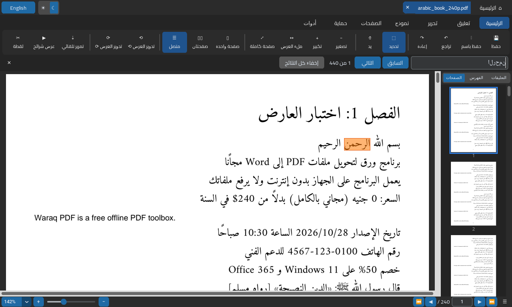
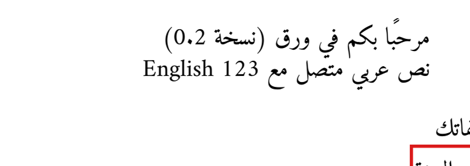
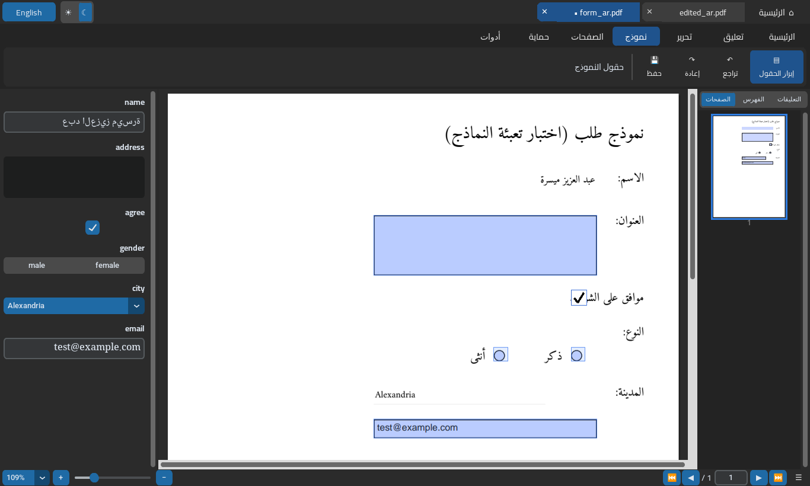

# دليل الاستخدام — Waraq PDF Manual

<div dir="rtl">

## البداية
شغّل `WaraqPDF.exe`. تظهر **الشاشة الرئيسية**: زر «فتح ملف PDF»، وبلاطات الأدوات، وقائمة «الملفات الأخيرة». يمكنك أيضًا سحب ملف PDF وإفلاته على النافذة، أو فتح الملف بالبرنامج من مستكشف الملفات (كليك يمين ← فتح باستخدام ← WaraqPDF.exe). زر **English/عربي** في الشريط العلوي يغيّر لغة الواجهة، وزر ☀/☾ يغيّر بين الوضع الفاتح والداكن. البرنامج يحفظ اختياراتك في `%APPDATA%\Waraq\settings.json`.

كل أداة تعمل بنفس الطريقة: اختر الملف ← اضبط الخيارات ← اضغط الزر ← اختر مكان الحفظ. البرنامج لا يكتب فوق الملف الأصلي أبدًا. إذا كان الملف محميًا بكلمة مرور، يطلبها البرنامج مرة واحدة ويتذكّرها حتى تغلقه.

- **دمج:** أضف الملفات، ورتّبها بزرَّي ▲ و▼، ثم اضغط «دمج وحفظ».
- **تقسيم:** اختر «كل صفحة في ملف»، أو «كل N صفحات»، أو «حسب النطاقات» (مثال `1-3, 5, 8-10`، وكل نطاق يصبح ملفًا منفصلًا)، أو «استخراج صفحات في ملف واحد».
- **ترتيب الصفحات:** اضغط «عرض الصفحات». اضغط على صورة الصفحة لتحديدها أو إلغاء تحديدها، ويمكنك تحديد أكثر من صفحة. بعدها دوّر أو احذف أو قدّم أو أخّر، ثم اضغط «حفظ باسم».
- **صور ⇄ PDF:** في تبويب «صور إلى PDF» يمكن جعل حجم الصفحة على قدر الصورة، أو A4، أو Letter، مع هامش. في تبويب «PDF إلى صور» تختار الدقة (DPI) والصيغة PNG أو JPG.
- **ضغط:** «خفيف» يحافظ على الجودة، و«متوازن» مناسب لمعظم الملفات، و«قوي» ينتج أصغر حجم. البرنامج يعرض الحجم قبل الضغط وبعده. إذا لم يقلّ الحجم، يبقى الملف الأصلي كما هو.
- **PDF إلى Word / نص:** اضغط «استخراج ومعاينة» وراجع النص، ثم احفظه كـ docx أو txt. اختر طريقة التنسيق: «فقرات» تدمج الأسطر في فقرات، و«حفظ الأسطر» تُبقي كل سطر كما هو. خيار الصفحات الممسوحة:
  - «تلقائي»: يستخدم OCR للصفحات التي لا تحتوي على نص.
  - «إجباري»: يستخدم OCR لكل الصفحات. استعمله عندما يظهر النص المستخرج حروفًا غريبة، لأن خط الملف تالف.
  - «بدون».
- **OCR:** يستخرج النص من ملف ممسوح ضوئيًا، أو ينشئ PDF قابلًا للبحث (هذه الخاصية تحتاج Tesseract).
- **توقيع / ختم:** اختر صورة التوقيع أو اكتب نصًا، ثم حدّد الصفحات (الأولى، أو الأخيرة، أو الكل، أو أرقام صفحات) والموضع والعرض. «إزالة الخلفية البيضاء» تجعل خلفية الصورة شفافة. اضغط «معاينة» قبل الحفظ.
- **كلمة المرور:** «إضافة» تشفّر الملف بـ AES-256، ويمكنك منع الطباعة أو النسخ. «إزالة» تحتاج كلمة المرور الصحيحة، فالبرنامج **لا** يكسر كلمات المرور.

## العارض والمحرر
كل ملف تفتحه يظهر في تبويب في الشريط العلوي. علامة «•» قبل الاسم تعني أن فيه تعديلات لم تُحفظ، وزر ✕ يغلق التبويب، وإذا كانت هناك تعديلات يسألك البرنامج قبل الإغلاق.

- **الرئيسية:** حفظ (Ctrl+S)، حفظ باسم، تراجع (Ctrl+Z)، إعادة (Ctrl+Y)، تحديد، يد للتحريك، تكبير وتصغير (Ctrl+عجلة الفأرة)، ملء العرض، ملء الصفحة، صفحة واحدة أو صفحتان أو متصل، تدوير العرض (لا يغيّر الملف)، تمرير تلقائي، عرض شرائح (Esc للخروج)، لقطة لجزء من الصفحة تُحفظ كصورة PNG، بحث (Ctrl+F)، وضع ليلي، طباعة.
- **الشريط الجانبي:** الصفحات (اضغط لتنتقل، وCtrl أو Shift لتحديد أكثر من صفحة)، والفهرس، والتعليقات.
- **البحث:** يتجاهل التشكيل والتطويل، ولا يفرّق بين أ/إ/آ/ا ولا بين ى/ي ولا بين ة/ه. كل النتائج تُظلَّل، والنتيجة الحالية بلون أغمق. استخدم «التالي» و«السابق» أو F3.
- **تحديد النص:** اسحب بأداة التحديد ثم Ctrl+C. النقر المزدوج يحدد السطر.
- **تعليق:** اختر الأداة ثم ارسم على الصفحة. التظليل والتسطير والشطب تتبع النص الذي تسحب عليه. «مربع نص» يفتح نافذة تكتب فيها النص وتختار الخط والحجم، مع معاينة بالشكل الصحيح للحروف العربية. اللون والسُمك وحجم الخط والتعبئة في يسار الشريط. لتعديل تعليق: انقر عليه مرتين. للنقل: اسحبه. لتغيير الحجم: اسحب المربعات الصغيرة. للحذف: زر Delete أو كليك يمين.
- **تحرير:**
  - «تعديل نص»: انقر على سطر واكتب النص الجديد (انظر الحدود بالأسفل).
  - «إضافة صورة» و«توقيع»: اختر الصورة ثم انقر في مكانها أو ارسم مستطيلًا. التوقيع تُزال خلفيته البيضاء.
  - «تغطية بالأبيض» و«إخفاء نهائي»: ارسم مستطيلًا على المكان.
  - يمكنك أيضًا إخفاء كل نتائج البحث بزر «إخفاء كل النتائج» في شريط البحث.
- **نموذج:** يعرض حقول النموذج في لوحة جانبية، وتُكتب القيم أيضًا على الصفحة مباشرة. زر «إبراز الحقول» يحدد أماكنها.
- **الصفحات:** تُطبَّق العمليات على الصفحات المحددة في الشريط الجانبي، أو على الصفحة الحالية إذا لم تحدد شيئًا.
- **حماية:** كلمة مرور، وإخفاء نهائي، وحفظ مدمج. **أدوات:** تفتح أدوات ورق الأخرى (ضغط، تحويل إلى Word، OCR…) على الملف المفتوح.

التعليقات تُحفظ كتعليقات PDF عادية، فتظهر في Acrobat وEdge وChrome وغيرها. زر «حفظ مدمج (Flatten)» في تبويب «حماية» يحفظ نسخة تكون فيها التعليقات وقيم النماذج جزءًا من الصفحة، فلا يمكن تعديلها.





### حدود العارض والمحرر
- **تعديل النص** ليس إعادة كتابة للفقرة. السطر يُغطّى بالأبيض ويُكتب فوقه النص الجديد، و**النص القديم يبقى داخل الملف** ويمكن نسخه. إذا كان الهدف إخفاء معلومة فاستخدم «إخفاء نهائي». الغطاء أبيض، فلا يناسب الخلفيات الملونة.
- **التغطية بالأبيض** شكلية فقط.
- **الإخفاء النهائي** يحذف النص والصور تحت المستطيل فعلًا، عن طريق تحويل **الصفحة كلها** إلى صورة 200 DPI. لذلك تصبح الصفحة غير قابلة للبحث أو للتحديد، وقد يكبر حجم الملف.
- التعليقات التي أنشأتها برامج أخرى تُعرض وتُحفظ كما هي، لكن لا يمكن تعديلها في ورق.
- الطباعة تُرسل نسخة من الملف إلى برنامج PDF الافتراضي في ويندوز. إذا كان البرنامج الافتراضي لا يدعم أمر الطباعة (كبعض إصدارات Edge)، تظهر رسالة فيها مسار النسخة لتطبعها يدويًا.
- لا يوجد OCR داخل العارض. استخدم أداة OCR من تبويب «أدوات».

## تفعيل التعرّف الضوئي (OCR) للعربية
يختار البرنامج أول محرّك متاح:
1. **OCR المدمج في ويندوز 10/11:** افتح الإعدادات ← الوقت واللغة ← اللغة والمنطقة ← أضف «العربية»، وتأكد أن «التعرّف الضوئي/الكتابة اليدوية» ضمن مكوّنات اللغة.
2. **Tesseract** (دقته أعلى غالبًا، ويدعم إنشاء PDF قابل للبحث): ثبّت Tesseract لويندوز (مثل نسخة UB Mannheim) واختر أثناء التثبيت حزمة اللغة العربية `ara`. يبحث عنه البرنامج في `Program Files` وفي `PATH`، أو في المسار الذي تضعه في متغيّر البيئة `WARAQ_TESSERACT`.

</div>

## Command line

`WaraqPDF.exe file.pdf [more.pdf]` opens the files in the viewer. Every tool is available from the command line: `WaraqPDF.exe <command> --help`
(or `python -m waraq` when running from source). Errors go to stderr as
`error[code]: message` and the exit code is 2.

```
WaraqPDF info file.pdf
WaraqPDF merge a.pdf b.pdf -o out.pdf
WaraqPDF split in.pdf -o outdir --mode ranges --ranges "1-3,5,8-10"
WaraqPDF rotate in.pdf -o out.pdf --angle 90 --pages 1,3
WaraqPDF delete in.pdf -o out.pdf --pages 2-4
WaraqPDF reorder in.pdf -o out.pdf --order 3,1,2
WaraqPDF img2pdf *.jpg -o out.pdf --page-size a4 --margin-mm 10
WaraqPDF pdf2img in.pdf -o outdir --dpi 150 --format png
WaraqPDF compress in.pdf -o out.pdf --preset balanced      # light|balanced|strong
WaraqPDF todocx in.pdf -o out.docx --layout paragraphs --ocr auto
WaraqPDF totext in.pdf -o out.txt
WaraqPDF ocr scan.pdf -o out.txt [--engine windows|tesseract] [--searchable]
WaraqPDF sign in.pdf -o out.pdf --image sig.png --pages last --position bottom-right --width 150 --remove-white
WaraqPDF protect in.pdf -o out.pdf --user-password 1234 [--no-print] [--no-copy]
WaraqPDF unlock in.pdf -o out.pdf --password 1234
```

## Limitations

- **Arabic PDF → Word:** text is rebuilt from glyph positions. Where the PDF
  producer mapped a glyph to the wrong Unicode character, the error is copied.
  The usual case is tanween or other harakat in ligatures, so a line can differ
  from the source in harakat only. The letters still come out right. PDFs with
  broken font encodings produce garbage in every tool. Use *Force OCR* for
  those, because Waraq does not detect garbage text layers on its own yet.
  Tables, columns, images and fonts are not reproduced in the Word file, only
  right-to-left paragraphs of text.
- **OCR:** Tesseract sometimes puts short English or number runs inside
  Arabic lines in the wrong order. Handwriting is not supported. Making a
  searchable PDF needs Tesseract.
- **Compress:** only images are re-encoded (JPEG) and streams recompressed.
  Fonts are not subset. Files that are mostly text shrink less.
- **Password:** only removing a password you know is supported. Certificate
  (public-key) encryption is not supported.
- **Signature:** this is a visual stamp, not a cryptographic digital signature.
- **Viewer / editor:**
  - *Edit text* is cover-and-replace: a white box plus new text, and the original text stays in the file underneath. There is no paragraph reflow.
  - *Whiteout* is visual only.
  - *Redact* removes content by rasterizing the whole page at 200 dpi, so that page loses selectable text.
  - Annotations from other apps are kept and shown but are not editable in Waraq.
  - Print uses the OS "print" verb of the default PDF app.
  - On Linux, Tk entry fields show Arabic unshaped (the page and dialog preview are correct).
  - Very large pages are rendered on demand, and about 100 MB of page bitmaps are cached.
- The exe is not code-signed, so SmartScreen will warn the first time it runs.
