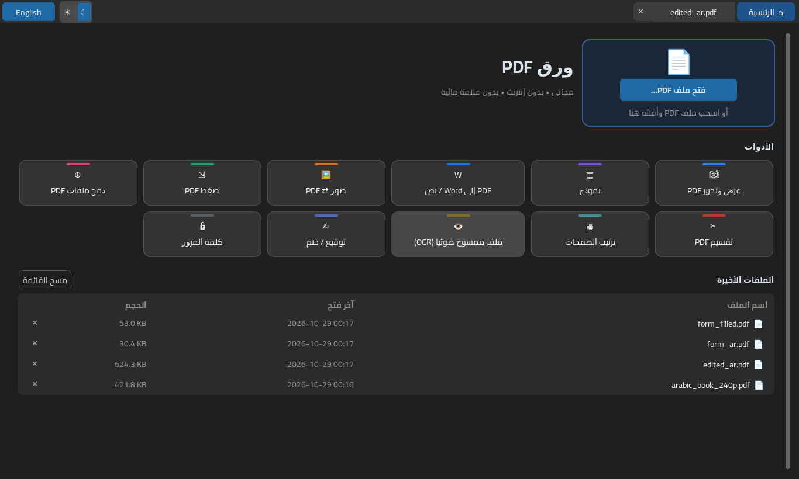
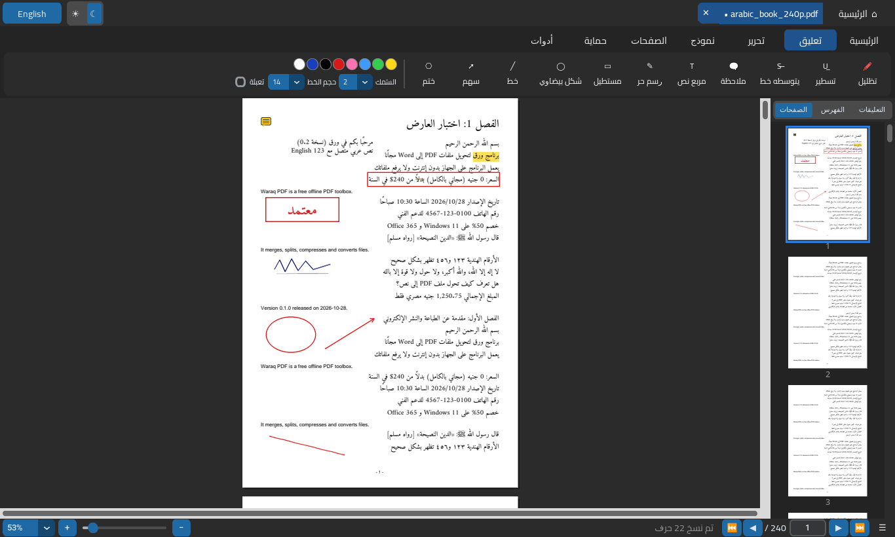
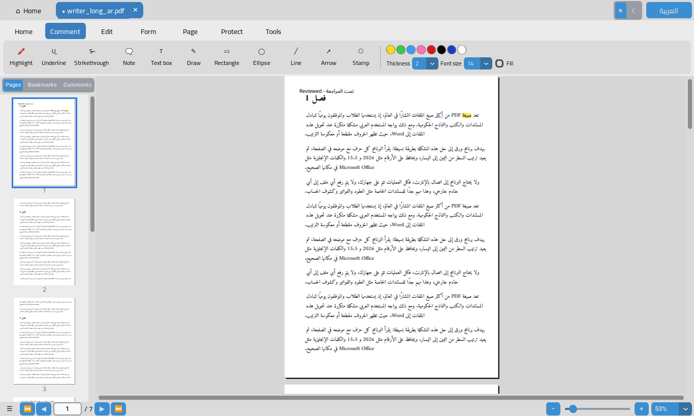

# ورق PDF — Waraq PDF

<div dir="rtl">

**ورق** برنامج مجاني لملفات PDF على ويندوز. يعمل بدون إنترنت، ولا يرفع ملفاتك لأي مكان، ولا يضع علامة مائية. واجهته عربية أولًا، ويمكن تحويلها إلى الإنجليزية بزر واحد.

## الأدوات

| الأداة | ماذا تفعل |
|---|---|
| دمج | دمج عدة ملفات PDF في ملف واحد بالترتيب الذي تختاره |
| تقسيم | كل صفحة في ملف، أو كل N صفحات، أو حسب نطاقات مثل `1-3, 5, 8-10`، أو استخراج صفحات في ملف واحد |
| ترتيب الصفحات | صور مصغّرة للصفحات: تدوير، حذف، تقديم وتأخير |
| صور ⇄ PDF | تحويل صور (JPG/PNG/…) إلى PDF، وتصدير صفحات PDF كصور |
| ضغط | ثلاث درجات: خفيف، متوازن، قوي |
| PDF إلى Word / نص | استخراج النص العربي **بالترتيب الصحيح** (بدون حروف مقلوبة أو مقطّعة)، مع معاينة قبل الحفظ |
| التعرّف الضوئي (OCR) | قراءة الملفات الممسوحة ضوئيًا: محرّك ويندوز المدمج أو Tesseract |
| توقيع / ختم | إضافة صورة توقيع أو ختم أو نص في موضع تختاره، مع إزالة الخلفية البيضاء |
| كلمة المرور | إضافة كلمة مرور، أو إزالتها **إذا كنت تعرفها** (البرنامج لا يكسر كلمات المرور) |

## الجديد في 0.2: عارض ومحرر PDF



- **شاشة رئيسية** فيها زر فتح ملف، وسحب وإفلات، وبلاطات الأدوات، وقائمة الملفات الأخيرة (الاسم، آخر فتح، الحجم).
- **العارض:** تبويبات لعدة ملفات، وتمرير متصل أو صفحة واحدة أو صفحتين (من اليمين لليسار للكتب العربية)، وتكبير وتصغير وملء العرض وملء الصفحة، وتدوير العرض، وصور مصغّرة وفهرس وقائمة تعليقات، وبحث عربي يتجاهل التشكيل وأشكال الألف والهمزة مع تظليل النتائج، وتحديد نص ونسخه، والانتقال لصفحة، ووضع ليلي، وعرض شرائح، وتمرير تلقائي، ولقطة لجزء من الصفحة، وطباعة.
- **التعليقات (تبويب «تعليق»):** تظليل، وتسطير، وشطب، وملاحظات لاصقة، ومربع نص عربي متصل الحروف ومن اليمين لليسار بخطوط مدمجة، ورسم حر، ومستطيل، وشكل بيضاوي، وخط، وسهم، وأختام. كل هذه تُحفظ **تعليقات PDF حقيقية** يراها Acrobat وEdge وغيرهما، ويمكن تعديلها مرة أخرى في ورق.
- **التحرير (تبويب «تحرير»):** تعديل نص موجود، وإضافة صورة، وتوقيع، وتغطية بالأبيض، وإخفاء نهائي (Redaction).
- **الصفحات:** تدوير، وحذف، وإدراج صفحة فارغة، وإدراج من ملف PDF آخر، وتكرار، ونقل، واستخراج.
- **النماذج:** تعبئة حقول النماذج (AcroForm) بالعربي.
- تراجع وإعادة (حتى 200 خطوة)، وحفظ آمن: يُكتب الملف في ملف مؤقت ويُفحص أولًا ثم يحلّ محل الأصلي. الملف المشفّر يبقى مشفّرًا.



### حدود يجب أن تعرفها
- **تعديل النص** ليس إعادة تدفق للفقرة كما في Word. البرنامج يغطي السطر بمستطيل أبيض ويكتب النص الجديد فوقه. **النص القديم يبقى داخل الملف** تحت الغطاء، فإذا كان سرًّا استخدم «إخفاء نهائي».
- **التغطية بالأبيض** شكلية فقط، والنص تحتها يمكن نسخه.
- **الإخفاء النهائي** يحذف المحتوى فعلًا، لكنه يحوّل **الصفحة كلها** إلى صورة بدقة 200 DPI، فلا يمكن تحديد نصها أو البحث فيها بعد ذلك.
- التعليقات التي أنشأتها برامج أخرى تُعرض كما هي، لكن لا يمكن تعديلها في ورق.
- الطباعة تُرسل الملف إلى برنامج الطباعة في النظام.

## التشغيل

- حمّل `WaraqPDF.exe` وشغّله. لا يحتاج إلى تثبيت.
- البرنامج غير موقّع رقميًا حتى الآن، لذلك قد يعرض ويندوز رسالة SmartScreen. اضغط «مزيد من المعلومات» ثم «تشغيل على أي حال».
- الدليل الكامل في [MANUAL.md](MANUAL.md).

</div>

---

**Waraq** ("paper") is a free, offline, Arabic-first PDF toolbox for Windows.
It does not upload anything, adds no watermark, and has an Arabic/English UI with
right-to-left layout.

**Tools** (besides the viewer/editor below): merge · split (each / every N / ranges / extract) · organize pages with
thumbnails (rotate, delete, reorder) · images ⇄ PDF · compress (3 presets) ·
Arabic-safe PDF → Word/TXT with a preview · OCR (Windows built-in OCR or
Tesseract) · signature / stamp · add or remove a password (known password only).
All tools are also available from the command line: `WaraqPDF.exe --help`.

### New in 0.2: viewer and editor

The 0.2 release adds a PDFgear-style home screen, a viewer and an editor:

- **Home:** open a file (button, drag-and-drop, double-click or a command-line
  argument), tool tiles, and a recent-files list.
- **Viewer:** tabs, continuous, single and two-page modes (RTL page order in
  Arabic), zoom / fit width / fit page, view rotation, thumbnails, bookmarks
  and an annotation list. Arabic-aware search ignores harakat and
  alef/hamza variants and highlights every hit. Also: text selection and
  copy, go to page, night mode, slide show, auto-scroll, a region screenshot
  and print.
- **Comment:** highlight, underline, strikethrough, sticky note, Arabic
  free-text box (shaped, RTL, bundled Amiri/Noto fonts), pen, rectangle,
  ellipse, line, arrow and stamps. These are saved as **real PDF
  annotations** with appearance streams, and Waraq can edit them again
  after reopening.
- **Edit:** edit text (cover-and-replace), image, signature, whiteout and
  true redaction.
- **Pages:** rotate, delete, insert a blank page, insert from a PDF,
  duplicate, move and extract.
- **Form:** AcroForm filling, including Arabic values.
- **Saving:** undo/redo (200 steps) and a safe save (write to a temp file,
  verify, replace). Encryption is kept.



Limits: there is no reflowing text editor. *Edit text* puts a white box plus
new text over a line, so **the old text stays in the file**. *Whiteout* is
visual only. *Redact* really removes content, but it rasterizes the whole page
at 200 dpi. Annotations made by other programs are shown, but Waraq cannot
edit them. Print hands the file to the operating system. On Linux the Tk
entry fields do not shape Arabic, although the page and the text-box preview
do; Windows is unaffected.

### Why the Arabic extraction is different

Most PDF tools return Arabic in *visual* order. Words come out reversed,
letters come out in presentation forms (ﻣﺮﺣﺒﺎ), and harakat or spaces end up in
the wrong place. Waraq rebuilds the logical text from glyph positions. It
converts presentation forms back to normal letters, attaches marks
geometrically, and applies the bidi algorithm in reverse per line. The Word
file it writes has right-to-left paragraphs. Measured results are in
[docs/benchmark.md](docs/benchmark.md). On the test files, every line matches
the source once harakat are ignored. On a real MS-Word PDF, 98.4% of words
are found in the reference vocabulary, against 96.0% for pypdf and 4.4% for
pdfminer.

### Build from source

```bash
python -m venv .venv && .venv\Scripts\activate
pip install -r requirements-dev.txt
python -m waraq                 # GUI
python -m waraq --help          # CLI
python tests/make_fixtures.py && python -m pytest -q tests
pyinstaller --onefile --windowed --name WaraqPDF --collect-all customtkinter ^
  --collect-all pypdfium2 --collect-all tkinterdnd2 --collect-submodules winrt --add-data "waraq/assets;waraq/assets" waraq_app.py
```

The GitHub Actions workflow `.github/workflows/build-windows.yml` runs the
tests on `windows-latest` and uploads `WaraqPDF.exe` as an artifact.

### Status

Version 0.2.0. See [MANUAL.md](MANUAL.md#limitations) for known
limitations. Licence: **MIT** (see [LICENSE](LICENSE)). Third-party licences: [LICENSE-NOTE.md](LICENSE-NOTE.md).
